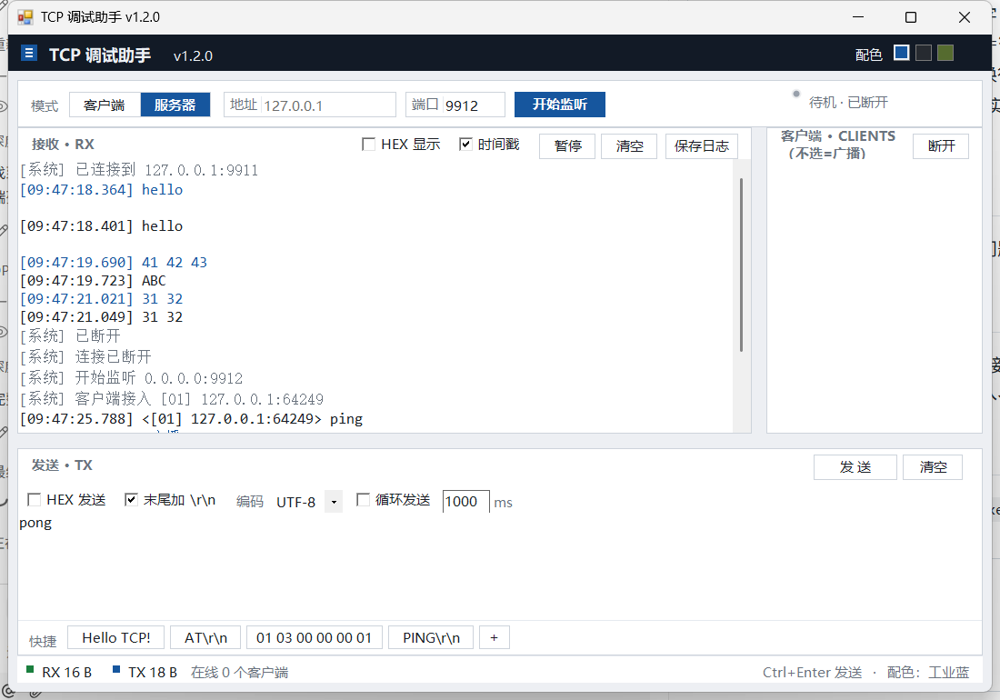

# TCP 调试助手

一个轻量级 Windows TCP 网络调试工具，C# WinForms 单文件实现，**无任何第三方依赖**。

  



## ✨ 功能

- **双模式**：TCP 客户端（主动连接）/ TCP 服务器（监听，支持多客户端）
- **工业简洁界面 v2**：深色顶栏、扁平卡片 + 1px 描边、状态指示灯（带光晕）、等宽数据字体
- **三套配色一键切换**：工业蓝 / 石墨深（深色模式）/ 军绿，自动记住上次选择
- **可拖动分区**：接收区 ↔ 发送区、接收区 ↔ 客户端列表 之间的分隔条可自由拖动调整
- **参数输入格**：地址 / 端口带内嵌标签的输入格，模式切换为分段式按钮
- **文本 / HEX 收发**：HEX 输入自动兼容空格、逗号、0x 前缀，自动校验偶数位
- **HEX 显示** / **时间戳**（精确到毫秒）/ **暂停显示** / 编码选择（UTF-8、GBK、ASCII）
- **快捷指令栏**：底部 6 个可自定义按钮（右键编辑、＋号新增），点击即发送，配置持久化到 `quick.txt`
- **多客户端管理**：在线客户端列表（带编号），选中 = 定向发送，不选 = 广播，可一键断开选中客户端
- **循环发送**：自定义间隔（ms）定时重发，适合工控设备轮询调试
- **颜色区分**：黑色 = 收到、蓝色 = 发出、灰色 = 系统消息、红色 = 错误
- **RX / TX 字节计数**（状态栏色块显示）、清空接收/发送、**保存日志**
- 快捷键：`Ctrl + Enter` 发送

## 🚀 使用

1. 到 [Releases](https://github.com/MM121202/tcp-debug-assistant/releases/latest) 下载 `TCP-Debug-Assistant.exe`，双击运行（Windows 7+，需 .NET Framework 4.x，系统自带）；
2. 顶部点「客户端」或「服务器」切换模式：
   - **客户端**：填服务器地址 + 端口 → 点「连 接」
   - **服务器**：填本机监听端口 → 点「开始监听」
3. 在下方输入框输入内容（或勾选 HEX 发送填 `01 03 00 00 00 01`）→ 点「发送」或按 `Ctrl+Enter`。

## 🔧 从源码编译

无需安装 Visual Studio / .NET SDK，Windows 自带 C# 编译器即可：

```bat
C:\Windows\Microsoft.NET\Framework64\v4.0.30319\csc.exe ^
  /target:winexe /codepage:65001 /out:TCP调试助手.exe ^
  /r:System.Windows.Forms.dll /r:System.Drawing.dll TCP调试助手.cs
```

或直接双击 `build.bat` 一键编译。

## 📁 文件说明

| 文件 | 说明 |
| --- | --- |
| `TCP调试助手.cs` | 全部源码（单文件，约 1300 行） |
| `build.bat` | 一键编译脚本 |
| `LICENSE` | MIT 许可证 |

## 📄 License

[MIT](LICENSE) © 2026 MM121202
